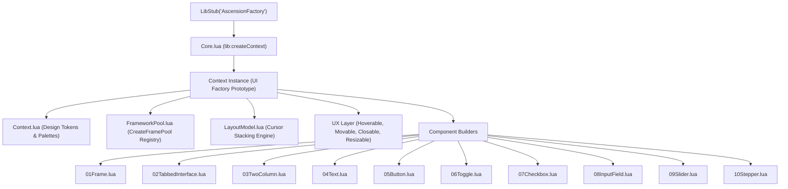
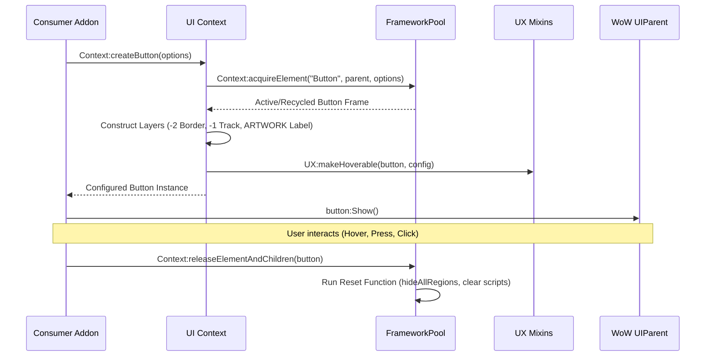

# AscensionFactory

An advanced, high-performance UI component library and layout framework for **World of Warcraft Retail (11.x / 12.x)** addons. Built with an **Obsidian & Cyberpunk Neon** design system, full memory recycling via Blizzard FramePools, procedural vector graphics, and an automatic cursor-based layout engine.

---

## Table of Contents

1. [Architecture Overview](#architecture-overview)
2. [Design System & Palette](#design-system--palette)
3. [Core Engine Subsystems](#core-engine-subsystems)
   - [Context Management](#context-management)
   - [Memory Pooling (FrameworkPool)](#memory-pooling-frameworkpool)
   - [Layout Model & Cursor Engine](#layout-model--cursor-engine)
   - [UX Interaction Modules](#ux-interaction-modules)
4. [Component API Reference](#component-api-reference)
   - [MainFrame](#mainframe)
   - [TabbedInterface](#tabbedinterface)
   - [TwoColumn](#twocolumn)
   - [Typography (Header, Label, Paragraph)](#typography)
   - [Buttons (Standard, Icon, Dialog)](#buttons)
   - [Toggle Switch](#toggle-switch)
   - [Checkbox](#checkbox)
   - [InputField](#inputfield)
   - [Slider & Scrollbar](#slider--scrollbar)
   - [Stepper](#stepper)
5. [Step-by-Step Recipes](#step-by-step-recipes)
6. [Component Extension Guide](#component-extension-guide)

---

## Architecture Overview

AscensionFactory is built upon an Object-Oriented metatable architecture wrapped inside LibStub. It separates design tokens, memory allocation, layout calculations, and interaction behaviors into distinct decoupled layers.

### System Architecture Diagram



### Component Lifecycle Flow



---

## Design System & Palette

All components consume standardized styling tokens from `uiContext.styles`. The default theme uses high-contrast Obsidian dark surfaces accented with vivid Neon lasers.

### Color Tokens

| Token | Hex / RGBA | Role / Usage |
| --- | --- | --- |
| `background` | `{0.008, 0.012, 0.020, 0.96}` | Deep Obsidian main window background |
| `panelBackground` | `{0.016, 0.024, 0.039, 0.60}` | Translucent container panel backdrop |
| `surfaceDark` | `{0.012, 0.020, 0.031, 0.90}` | Inner input and slider track background |
| `surfaceLight` | `{0.027, 0.039, 0.059, 0.90}` | Normal button and card surface |
| `surfaceHover` | `{0.055, 0.075, 0.110, 0.95}` | Hover state surface highlight |
| `border` | `{0.078, 0.102, 0.141, 1.00}` | Default structural frame border |
| `steelHighlight` | `{0.122, 0.153, 0.208, 1.00}` | Hover border highlight |
| `primary` | `{1.000, 0.380, 0.000, 1.00}` | Vivid Neon Orange accent & active border |
| `primaryHover` | `{1.000, 0.540, 0.050, 1.00}` | Laser Orange interactive hover state |
| `primaryActive` | `{0.700, 0.220, 0.000, 1.00}` | Deep Ember Orange pressed state |
| `neonRed` | `{1.000, 0.000, 0.150, 1.00}` | Close buttons and dangerous actions |
| `neonGreen` | `{0.000, 1.000, 0.400, 1.00}` | Confirm / Accept dialog actions |
| `white` | `{0.922, 0.973, 1.000, 1.00}` | Primary text labels and diamond thumbs |

---

## Core Engine Subsystems

### Context Management

[Core.lua](file:///Applications/World%20of%20Warcraft/_retail_/Interface/AddOns/AscensionFactory/Core/Core.lua)

Each consumer addon initializes an isolated Context:

```lua
local AscensionFactory = LibStub("AscensionFactory")
local uiContext = AscensionFactory:createContext()
```

Custom styles can be passed into `createContext(customStyles)` to override tokens per addon.

---

### Memory Pooling (FrameworkPool)

[FrameworkPool.lua](file:///Applications/World%20of%20Warcraft/_retail_/Interface/AddOns/AscensionFactory/Core/FrameworkPool.lua)

Prevents Lua garbage collection pauses by reusing Blizzard frames via `CreateFramePool`, `CreateTexturePool`, and `CreateFontStringPool`.

- `Context:acquireElement(elementType, parent, options)`: Returns a recycled or fresh widget instance (`"Frame"`, `"Button"`, `"StatusBar"`, `"CheckButton"`, `"EditBox"`, `"ScrollFrame"`, `"Slider"`, `"Model"`, `"Texture"`, `"FontString"`).
- `Context:releaseElement(elementType, element)`: Returns a single element to its pool.
- `Context:releaseElementAndChildren(element)`: Recursively resets and releases a frame along with all its child frames and regions.
- `Context:releaseAllElements()`: Resets and recycles all allocated pools.

---

### Layout Model & Cursor Engine

[LayoutModel.lua](file:///Applications/World%20of%20Warcraft/_retail_/Interface/AddOns/AscensionFactory/Core/LayoutModel.lua)

Provides dynamic cursor-based relative positioning. Developers stack widgets sequentially without hardcoding pixel coordinates.

```lua
local layout = uiContext:createLayoutModel(contentPanel)

layout:header("SectionHeader", "General Settings")
layout:addSpace(10)
layout:checkbox("AutoTargetCheckbox", "Enable Auto Target", getter, setter)
layout:button("ApplyButton", "Save Changes", nil, 120, 26, onClickCallback)
```

#### Layout Engine Features

- **Sections (`beginSection(width)` / `endSection()`)**: Wraps widgets in an Obsidian bordered card that automatically stretches its bottom to wrap enclosed contents.
- **Columns (`beginColumn(xOffset, width)` / `endColumn()` / `columnsFinalize(contentFrame, padding)`)**: Balances multi-column layouts and automatically sizes the parent container to match the tallest column.

---

### UX Interaction Modules

| Module | File | Method | Description |
| --- | --- | --- | --- |
| **Hoverable** | [Hoverable.lua](file:///Applications/World%20of%20Warcraft/_retail_/Interface/AddOns/AscensionFactory/UX/Hoverable.lua) | `UX:makeHoverable(element, config)` | Attaches unified `normal`, `hover`, `active`, `disabled` state management, custom color maps, and tooltips. |
| **Closable** | [Closable.lua](file:///Applications/World%20of%20Warcraft/_retail_/Interface/AddOns/AscensionFactory/UX/Closable.lua) | `UX:makeClosableWithEscape(frame, config)` | Binds Escape key to close the window, with optional pool release via `config.releaseOnHide`. |
| **Draggable** | [Draggable.lua](file:///Applications/World%20of%20Warcraft/_retail_/Interface/AddOns/AscensionFactory/UX/Draggable.lua) | `UX:makeMovable(frame, config)` | Enables left-click dragging, screen clamping, and automatic SavedVariables coordinate persistence. |
| **Resizable** | [Resizable.lua](file:///Applications/World%20of%20Warcraft/_retail_/Interface/AddOns/AscensionFactory/UX/Resizable.lua) | `UX:makeResizable(frame, minW, minH)` | Adds a bottom-right drag handle with `SetResizeBounds` constraints. |

---

## Component API Reference

> [!NOTE]
> For a complete quick-reference matrix of all constructors, sub-elements, and option properties, see the [Components Index](file:///Applications/World%20of%20Warcraft/_retail_/Interface/AddOns/AscensionFactory/Components/README.md).

### MainFrame

[01Frame.lua](file:///Applications/World%20of%20Warcraft/_retail_/Interface/AddOns/AscensionFactory/Components/01Frame.lua)

Creates a styled top-level application window with background, border, close button, dragging, and escape key closure.

```lua
local frame = uiContext:createMainFrame({
    name = "MyAddonMainWindow",
    width = 800,
    height = 500,
    anchor = "CENTER",
    strata = "DIALOG",
    showCloseButton = true,
    onClose = function(self) self:Hide() end
})
```

#### Options Table (createMainFrame)

- `name` *(string, required)*: Global variable identifier for the frame registered in `_G`.
- `width` *(number, default: 860)*: Window width in pixels.
- `height` *(number, default: 500)*: Window height in pixels.
- `anchor` *(string, default: "CENTER")*: Screen anchor point.
- `strata` *(string, default: "DIALOG")*: Frame strata layer.
- `showCloseButton` *(boolean, default: true)*: Renders top-right close icon button.
- `closeButtonSize` *(number, default: 24)*: Pixel dimensions of close button.
- `closeButtonXOffset` *(number, default: -8)*: Horizontal offset for close button.
- `closeButtonYOffset` *(number, default: -8)*: Vertical offset for close button.
- `onClose` *(function)*: Callback executed when close button is clicked.
- `releaseOnHide` *(boolean, default: false)*: Automatically recycles frame to pool when hidden.

#### Return Table (createMainFrame)

- `frame` *(Frame)*: Configured top-level application window frame with attached properties:
  - `frame.globalName` *(string)*: Global identifier registered in `_G`.
  - `frame.border` *(Texture)*: Outer border texture layer (`BACKGROUND`, -2).
  - `frame.background` *(Texture)*: Inner surface background texture layer (`BACKGROUND`, -1).
  - `frame.closeButton` *(Button, optional)*: Top-right icon button instance (if `showCloseButton ~= false`).

---

### TabbedInterface

[02TabbedInterface.lua](file:///Applications/World%20of%20Warcraft/_retail_/Interface/AddOns/AscensionFactory/Components/02TabbedInterface.lua)

Creates a sidebar navigation with tab buttons and dynamic content panels.

```lua
local tabSystem = uiContext:createTabbedInterface({
    parent = mainFrame,
    startY = -40,
    initialIndex = 1,
    tabs = { "General", "Combat", "Profiles" }
})

local generalPanel = tabSystem.panels[1]
local combatPanel = tabSystem.panels[2]
```

#### Options Table (createTabbedInterface)

- `parent` *(Frame, required)*: Parent frame hosting the navigation sidebar and content panels.
- `startY` *(number, optional)*: Top offset in pixels where the sidebar begins positioning.
- `initialIndex` *(number, optional)*: 1-based index of the tab selected by default upon creation.
- `tabs` *(table of strings, required)*: Ordered list of tab names (e.g. `{"General", "Combat", "Profiles"}`).

#### Return Table (createTabbedInterface)

- `sidebar` *(Frame)*: Left vertical container hosting tab navigation buttons.
- `tabs` *(table of Button)*: Array of interactive tab button frames (`tabs[1]..tabs[N]`). Handles click events, hover states, and active accent indicators.
- `panels` *(table of Frame)*: Array of content container frames (`panels[1]..panels[N]`) matching tab indices 1:1. Use each panel as `parent` when creating sub-controls (checkboxes, sliders, inputs). Clicking a tab automatically calls `:Show()` on the matching panel and `:Hide()` on all other panels.

---

### TwoColumn

[03TwoColumn.lua](file:///Applications/World%20of%20Warcraft/_retail_/Interface/AddOns/AscensionFactory/Components/03TwoColumn.lua)

Splits the parent width evenly into a left and right frame.

```lua
local leftCol, rightCol = uiContext:createTwoColumns({
    parent = contentPanel,
    yOffset = -10,
    height = 200,
    name = "MySettingsColumns"
})
```

#### Options Table (createTwoColumns)

- `parent` *(Frame, default: UIParent)*: Parent frame hosting the two columns.
- `yOffset` *(number, default: 0)*: Top offset in pixels relative to parent.
- `height` *(number, optional)*: Fixed height for both columns in pixels (defaults to stretching to parent bottom).
- `name` *(string, default: "TwoColumnLayout")*: Base name for registering `_G[name .. "Left"]` and `_G[name .. "Right"]`.
- `backgroundColor` *(table of RGBA, optional)*: Background color for both columns.
- `leftBackgroundColor` *(table of RGBA, optional)*: Background color override for left column.
- `rightBackgroundColor` *(table of RGBA, optional)*: Background color override for right column.

#### Return Table (createTwoColumns)

- `leftColumn` *(Frame)*: Left-half container frame with 5px margin.
- `rightColumn` *(Frame)*: Right-half container frame with 5px margin.

---

### Typography

[04Text.lua](file:///Applications/World%20of%20Warcraft/_retail_/Interface/AddOns/AscensionFactory/Components/04Text.lua)

#### 1. Header (createHeader)

```lua
local header, nextY = uiContext:createHeader({
    parent = panel,
    text = "Combat Options",
    fontSize = 24,
    spaceBelow = 10
})
```

#### Options Table (createHeader)

- `parent` *(Frame, default: UIParent)*: Parent frame hosting the header text.
- `text` *(string, required)*: Header string content.
- `fontSize` *(number, default: 24)*: Font point size.
- `fontFamily` *(string, default: "fonts/frizqt___cyr.ttf")*: Font file path.
- `point` / `anchorPoint` *(string, default: "TOPLEFT")*: Frame anchor point.
- `relativeTo` *(Frame, default: parent)*: Target frame to anchor against.
- `relativePoint` *(string, default: "TOPLEFT")*: Relative anchor point on target frame.
- `xOffset` *(number, default: 0)*: Horizontal pixel offset.
- `yOffset` *(number, default: 0)*: Vertical pixel offset.
- `width` *(number, optional)*: Explicit text width constraint.
- `rightOffset` *(number, optional)*: Right padding offset to anchor against parent right edge.
- `spaceBelow` *(number, default: 0)*: Extra spacing in pixels added below header when calculating next Y offset.
- `shadowColor` *(table of RGBA, default: styles.colors.surfaceDark)*: Drop shadow color.
- `wordWrap` *(boolean, optional)*: Enables or disables word wrapping.
- `justifyH` *(string, optional)*: Horizontal text alignment (`"LEFT"`, `"CENTER"`, `"RIGHT"`).

#### Return Table (createHeader)

- `header` *(FontString)*: Configured header text FontString instance.
- `nextY` *(number)*: Computed Y coordinate offset positioned directly below header (including `spaceBelow`).

#### 2. Label (createLabel)

```lua
local label, nextY = uiContext:createLabel({
    parent = panel,
    text = "Targeting Mode",
    fontSize = 16,
    yOffset = nextY
})
```

#### Options Table (createLabel)

- `parent` *(Frame, default: UIParent)*: Parent frame hosting the label.
- `text` *(string, required)*: Label string content.
- `fontSize` *(number, default: 18)*: Font point size.
- `fontFamily` *(string, default: "fonts/frizqt___cyr.ttf")*: Font file path.
- `point` / `anchorPoint` *(string, default: "TOPLEFT")*: Frame anchor point.
- `relativeTo` *(Frame, default: parent)*: Target frame to anchor against.
- `relativePoint` *(string, default: "TOPLEFT")*: Relative anchor point on target frame.
- `xOffset` *(number, default: 0)*: Horizontal pixel offset.
- `yOffset` *(number, default: 0)*: Vertical pixel offset.
- `width` *(number, optional)*: Explicit text width constraint.
- `rightOffset` *(number, optional)*: Right padding offset to anchor against parent right edge.
- `spaceBelow` *(number, default: 0)*: Extra spacing in pixels added below label when calculating next Y offset.
- `shadowColor` *(table of RGBA, default: styles.colors.black)*: Drop shadow color.
- `wordWrap` *(boolean, optional)*: Enables or disables word wrapping.
- `justifyH` *(string, optional)*: Horizontal text alignment (`"LEFT"`, `"CENTER"`, `"RIGHT"`).

#### Return Table (createLabel)

- `label` *(FontString)*: Configured single-line label FontString instance.
- `nextY` *(number)*: Computed Y coordinate offset positioned directly below label (including `spaceBelow`).

#### 3. Paragraph (createParagraph)

```lua
local para, nextY = uiContext:createParagraph({
    parent = panel,
    text = "Long descriptive text explaining feature details...",
    fontSize = 12,
    yOffset = nextY
})
```

#### Options Table (createParagraph)

- `parent` *(Frame, default: UIParent)*: Parent frame hosting the paragraph.
- `text` *(string, required)*: Multi-line string content.
- `fontSize` *(number, default: 12)*: Font point size.
- `fontFamily` *(string, default: "fonts/frizqt___cyr.ttf")*: Font file path.
- `point` / `anchorPoint` *(string, default: "TOPLEFT")*: Frame anchor point.
- `relativeTo` *(Frame, default: parent)*: Target frame to anchor against.
- `relativePoint` *(string, default: "TOPLEFT")*: Relative anchor point on target frame.
- `xOffset` *(number, default: 0)*: Horizontal pixel offset.
- `yOffset` *(number, default: 0)*: Vertical pixel offset.
- `width` *(number, optional)*: Explicit width constraint.
- `rightOffset` *(number, default: -10 or -xOffset)*: Right padding offset relative to parent.
- `spaceBelow` *(number, default: 0)*: Extra spacing in pixels added below paragraph when calculating next Y offset.
- `justifyH` *(string, default: "LEFT")*: Horizontal text alignment (`"LEFT"`, `"CENTER"`, `"RIGHT"`).

#### Return Table (createParagraph)

- `paragraph` *(FontString)*: Configured multi-line wrapped FontString instance.
- `nextY` *(number)*: Computed Y coordinate offset positioned directly below wrapped paragraph (including `spaceBelow`).

---

### Buttons

[05Button.lua](file:///Applications/World%20of%20Warcraft/_retail_/Interface/AddOns/AscensionFactory/Components/05Button.lua)

#### 1. Standard Button (createButton)

```lua
local btn = uiContext:createButton({
    parent = panel,
    text = "Save Settings",
    width = 140,
    height = 28,
    onClick = function(self) print("Saved!") end
})
```

#### Options Table (createButton)

- `parent` *(Frame, default: UIParent)*: Parent container frame.
- `name` *(string, optional)*: Global variable identifier registered in `_G`.
- `text` *(string, default: "")*: Button label text.
- `width` *(number, default: 60)*: Button width in pixels.
- `height` *(number, default: 25)*: Button height in pixels.
- `point` / `anchorPoint` *(string, default: "TOPLEFT")*: Frame anchor point.
- `relativeTo` *(Frame, default: parent)*: Target frame to anchor against.
- `relativePoint` *(string, default: "TOPLEFT")*: Relative anchor point on target frame.
- `xOffset` *(number, default: 0)*: Horizontal pixel offset.
- `yOffset` *(number, default: 0)*: Vertical pixel offset.
- `onClick` *(function)*: Click event callback handler.
- `clickTypes` *(table of strings, default: {"AnyUp"})*: Registered mouse click events (e.g. `{"LeftButtonUp", "RightButtonUp"}`).
- `tooltip` *(table | string, optional)*: Tooltip description text or table configuration.
- `trackColors` *(table, optional)*: Color map table for inner track (`normal`, `hover`, `active`, `disabled`).
- `borderColors` *(table, optional)*: Color map table for outer border (`normal`, `hover`, `active`, `disabled`).
- `labelColors` *(table, optional)*: Color map table for text label (`normal`, `hover`, `active`, `disabled`).

#### Return Table (createButton)

- `button` *(Button)*: Interactive button frame with attached sub-elements:
  - `button.border` *(Texture)*: Outer border texture layer.
  - `button.track` *(Texture)*: Inner surface track texture layer.
  - `button:GetFontString()` *(FontString)*: Centered text label.

#### 2. Icon Button (createIconButton)

`iconType`: `"close"`, `"minus"`, `"plus"`, `"minimize"`, `"maximize"`, `"arrowdown"`.

```lua
local iconBtn = uiContext:createIconButton({
    parent = panel,
    iconType = "plus",
    size = 24,
    onClick = function() print("Added") end
})
```

#### Options Table (createIconButton)

- `parent` *(Frame, default: UIParent)*: Parent container frame.
- `name` *(string, optional)*: Global variable identifier registered in `_G`.
- `size` *(number, default: 24)*: Square button width and height in pixels.
- `iconType` *(string, default: "close")*: Geometric shape (`"close"`, `"minus"`, `"plus"`, `"minimize"`, `"maximize"`, `"arrowdown"`).
- `iconColor` *(table of RGBA, default: styles.colors.white)*: Icon drawing color tint.
- `point` / `anchorPoint` *(string, default: "TOPLEFT")*: Frame anchor point.
- `relativeTo` *(Frame, default: parent)*: Target frame to anchor against.
- `relativePoint` *(string, default: "TOPLEFT")*: Relative anchor point on target frame.
- `xOffset` *(number, default: 0)*: Horizontal pixel offset.
- `yOffset` *(number, default: 0)*: Vertical pixel offset.
- `onClick` *(function)*: Click event callback handler.
- `tooltip` *(table | string, optional)*: Tooltip description text or table configuration.

#### Return Table (createIconButton)

- `button` *(Button)*: Square icon button frame with dynamically rendered geometric vector icon textures on layer `ARTWORK`.

#### 3. Dialog Button (createDialogButton)

`variant`: `"accept"` (Green Neon), `"cancel"` (Red Neon), `"neutral"` (Orange Neon).

```lua
local acceptBtn = uiContext:createDialogButton({
    parent = panel,
    variant = "accept",
    text = "Confirm",
    onClick = function() print("Confirmed") end
})
```

#### Options Table (createDialogButton)

- `parent` *(Frame, default: UIParent)*: Parent container frame.
- `name` *(string, optional)*: Global variable identifier registered in `_G`.
- `variant` *(string, default: "neutral")*: Semantic style variant (`"accept"`, `"cancel"`, `"neutral"`).
- `text` *(string, optional)*: Button text (defaults to `"Accept"`, `"Cancel"`, or `"Button"` depending on variant).
- `width` *(number, default: 90)*: Base width in pixels (auto-expands for longer text).
- `height` *(number, default: 26)*: Height in pixels.
- `point` / `anchorPoint` *(string, default: "TOPLEFT")*: Frame anchor point.
- `xOffset` *(number, default: 0)*: Horizontal pixel offset.
- `yOffset` *(number, default: 0)*: Vertical pixel offset.
- `onClick` *(function)*: Click event callback handler.
- `tooltip` *(table | string, optional)*: Tooltip description text or table configuration.

#### Return Table (createDialogButton)

- `button` *(Button)*: Pre-styled action button with neon border and label color palette matching semantic variant.

---

### Toggle Switch

[06Toggle.lua](file:///Applications/World%20of%20Warcraft/_retail_/Interface/AddOns/AscensionFactory/Components/06Toggle.lua)

Binary switch with sliding thumb block and multi-state neon lighting.

```lua
local toggle = uiContext:createToggle({
    parent = panel,
    width = 52,
    height = 24,
    getter = function() return MyAddonDB.enabled end,
    setter = function(state) MyAddonDB.enabled = state end,
    onClick = function(self, state) print("Toggled:", state) end
})
```

#### Options Table (createToggle)

- `parent` *(Frame, default: UIParent)*: Parent container frame.
- `name` *(string, optional)*: Global variable identifier registered in `_G`.
- `width` *(number, default: 52)*: Switch width in pixels.
- `height` *(number, default: 24)*: Switch height in pixels.
- `padding` *(number, default: 2)*: Inset padding between sliding thumb and track border.
- `point` / `anchorPoint` *(string, default: "TOPLEFT")*: Frame anchor point.
- `xOffset` *(number, default: 0)*: Horizontal pixel offset.
- `yOffset` *(number, default: 0)*: Vertical pixel offset.
- `getter` *(function, optional)*: Function returning initial boolean state (`true` / `false`).
- `setter` *(function(state), optional)*: Callback invoked with new boolean state when toggled.
- `onClick` *(function(self, state), optional)*: Additional click callback handler.
- `tooltip` *(table | string, optional)*: Tooltip description text or table configuration.
- `scripts` *(table, optional)*: Extra script handlers to set or hook on the frame.

#### Return Table (createToggle)

- `toggle` *(Button)*: Interactive toggle switch frame with attached properties:
  - `toggle.border` *(Texture)*: Outer border box (`BACKGROUND`, -2).
  - `toggle.track` *(Texture)*: Inner surface track (`BACKGROUND`, -1).
  - `toggle.thumb` *(Texture)*: Sliding thumb block (`ARTWORK`).
  - `toggle.isOn` *(boolean)*: Current boolean state.

#### Public Instance Methods (Toggle)

- `toggle:setState(state)`: Updates boolean state and slides thumb.

---

### Checkbox

[07Checkbox.lua](file:///Applications/World%20of%20Warcraft/_retail_/Interface/AddOns/AscensionFactory/Components/07Checkbox.lua)

Geometric vector checkmark rendered without raster image assets.

```lua
local checkbox = uiContext:createCheckbox({
    parent = panel,
    text = "Auto Repair Equipment",
    checked = true,
    setter = function(val) MyAddonDB.autoRepair = val end
})
```

#### Options Table (createCheckbox)

- `parent` *(Frame, default: UIParent)*: Parent container frame.
- `name` *(string, optional)*: Global variable identifier registered in `_G`.
- `text` *(string, default: "")*: Checkbox label text displayed beside box.
- `checked` *(boolean, default: false)*: Initial checked state (used if no `getter` provided).
- `boxSize` / `size` *(number, default: buttonHeight)*: Dimensions of square check box in pixels.
- `width` *(number, optional)*: Total row width in pixels (defaults to auto-fitting box + label width).
- `point` / `anchorPoint` *(string, default: "TOPLEFT")*: Frame anchor point.
- `xOffset` *(number, default: 0)*: Horizontal pixel offset.
- `yOffset` *(number, default: 0)*: Vertical pixel offset.
- `getter` *(function, optional)*: Function returning current boolean state.
- `setter` *(function(val), optional)*: Callback invoked with updated boolean state.
- `onClick` *(function(self, checked, buttonName, down), optional)*: Additional click handler.
- `tooltip` *(table | string, optional)*: Tooltip description text or table configuration.

#### Return Table (createCheckbox)

- `checkbox` *(Button)*: Interactive row button containing box border, track, vector checkmark, and label:
  - `checkbox.boxBorder` *(Texture)*: Square border texture.
  - `checkbox.boxTrack` *(Texture)*: Inner box background texture.
  - `checkbox.checkShortLeg` *(Texture)*: 45-degree vector checkmark short leg texture (`ARTWORK`).
  - `checkbox.checkLongLeg` *(Texture)*: 45-degree vector checkmark long leg texture (`ARTWORK`).
  - `checkbox.label` *(FontString)*: Attached text label.
  - `checkbox.isChecked` *(boolean)*: Current checked state.

#### Public Instance Methods (Checkbox)

- `checkbox:getChecked()` -> `boolean`
- `checkbox:setChecked(isChecked)`
- `checkbox:setText(newText)`

---

### InputField

[08InputField.lua](file:///Applications/World%20of%20Warcraft/_retail_/Interface/AddOns/AscensionFactory/Components/08InputField.lua)

Unified text input supporting single-line entries, multi-line areas, numeric filtering, ghost placeholder text, clear button, and focus glows.

```lua
local input = uiContext:createInputField({
    parent = panel,
    width = 240,
    height = 26,
    placeholder = "Search inventory...",
    showClear = true,
    onTextChanged = function(self, text, isUserInput) ... end,
    onEnterPressed = function(self, text) ... end
})
```

#### Options Table (createInputField)

- `parent` *(Frame, default: UIParent)*: Parent container frame.
- `name` *(string, optional)*: Global variable identifier registered in `_G`.
- `width` *(number, required)*: Container pixel width.
- `height` *(number, required)*: Container pixel height.
- `text` *(string, default: "")*: Initial text string.
- `placeholder` *(string, default: "")*: Ghost placeholder text displayed when empty and unfocused.
- `multiLine` *(boolean, default: false)*: Enables multi-line text editing with automatic wrapping.
- `showClear` / `clearButton` *(boolean, default: false)*: Renders clear icon button on right edge (single-line only).
- `showScrollbar` *(boolean, default: false)*: Enables vertical scrollbar on right edge (multi-line only).
- `numeric` *(boolean, default: false)*: Restricts input characters strictly to numbers.
- `password` *(boolean, default: false)*: Masks entered characters with dots.
- `autoFocus` *(boolean, default: false)*: Automatically captures keyboard focus upon creation.
- `maxLetters` / `maxLength` *(number, default: 0)*: Maximum character length (0 for unlimited).
- `font` *(FontObject | string, default: "GameFontHighlight")*: Font object for text.
- `point` / `anchorPoint` *(string, default: "TOPLEFT")*: Frame anchor point.
- `xOffset` *(number, default: 0)*: Horizontal pixel offset.
- `yOffset` *(number, default: 0)*: Vertical pixel offset.
- `getter` *(function, optional)*: Function returning initial text string.
- `setter` *(function(text), optional)*: Callback invoked whenever text changes by user input.
- `onTextChanged` *(function(container, text, isUserInput), optional)*: Text change handler.
- `onEnterPressed` *(function(container, text), optional)*: Enter key pressed handler.
- `onEscapePressed` *(function(container), optional)*: Escape key pressed handler.

#### Return Table (createInputField)

- `container` *(Frame)*: Outer container frame with embedded widgets and public methods:
  - `container.border` *(Texture)*: Outer border texture layer.
  - `container.track` *(Texture)*: Inner surface background layer.
  - `container.editBox` *(EditBox)*: Underlying native WoW EditBox widget.
  - `container.placeholder` *(FontString)*: Ghost placeholder FontString.
  - `container.clearButton` *(Button, optional)*: Clear icon button (if `showClear = true`).
  - `container.scrollFrame` *(ScrollFrame, optional)*: Parent scroll frame (if `multiLine = true`).
  - `container.scrollbar` *(Slider, optional)*: Vertical scrollbar slider (if `showScrollbar = true`).

#### Public Instance Methods (InputField)

- `input:getText()` -> `string`
- `input:setText(newText)`
- `input:clear()`
- `input:setPlaceholder(placeholderText)`
- `input:setNumeric(isNumeric)`
- `input:setMaxLetters(maxLetters)`
- `input:setFocus()`
- `input:clearFocus()`
- `input:setEnabled(enabled)`
- `input:getEditBox()` -> Native EditBox

---

### Slider & Scrollbar

[09Slider.lua](file:///Applications/World%20of%20Warcraft/_retail_/Interface/AddOns/AscensionFactory/Components/09Slider.lua)

Supports horizontal and vertical orientations, rotated diamond thumb handle, progress bar fill, mouse wheel adjustments, and discrete step snapping.

```lua
local slider = uiContext:createSlider({
    parent = panel,
    orientation = "HORIZONTAL",
    length = 260,
    thickness = 16,
    minValue = 0,
    maxValue = 100,
    step = 5,
    value = 50,
    showFill = true,
    onValueChanged = function(self, val, isUserInput)
        print("Value:", val)
    end
})
```

#### Options Table (createSlider)

- `parent` *(Frame, default: UIParent)*: Parent container frame.
- `name` *(string, optional)*: Global variable identifier registered in `_G`.
- `orientation` *(string, required)*: Slider axis orientation (`"HORIZONTAL"` or `"VERTICAL"`).
- `length` *(number, required)*: Length along primary axis in pixels (`width` for horizontal, `height` for vertical).
- `thickness` *(number, default: 16 horizontal / 14 vertical)*: Thickness across secondary axis in pixels.
- `minValue` / `min` *(number, default: 0)*: Minimum allowed value.
- `maxValue` / `max` *(number, default: 100)*: Maximum allowed value.
- `step` / `stepSize` *(number, default: 1)*: Discrete step increment snapping.
- `value` / `defaultValue` *(number, default: minValue)*: Initial numerical value.
- `showFill` / `fill` *(boolean, default: false)*: Displays colored progress fill bar behind thumb.
- `fillColor` *(table of RGBA, default: styles.colors.primary)*: Color for progress fill bar.
- `thumbSize` *(number, default: thickness - 2)*: Pixel dimensions of diamond thumb button.
- `inverted` *(boolean, default: false)*: Inverts direction of min and max values.
- `point` / `anchorPoint` *(string, default: "TOPLEFT")*: Frame anchor point.
- `xOffset` *(number, default: 0)*: Horizontal pixel offset.
- `yOffset` *(number, default: 0)*: Vertical pixel offset.
- `getter` *(function, optional)*: Function returning initial numerical value.
- `setter` *(function(val), optional)*: Callback invoked on value change from user interaction.
- `onValueChanged` *(function(self, val, isUserInput), optional)*: Value change callback handler.

#### Return Table (createSlider)

- `slider` *(Frame)*: Slider container frame with attached interactive elements:
  - `slider.border` *(Texture)*: Outer border texture layer.
  - `slider.track` *(Texture)*: Inner surface track layer.
  - `slider.fill` *(Texture)*: Progress bar fill texture layer.
  - `slider.thumb` *(Button)*: Interactive thumb button with rotated 45-degree diamond texture (`slider.thumb.diamond`).
  - `slider.currentValue` *(number)*: Current numerical value.

#### Public Instance Methods (Slider)

- `slider:getValue()` -> `number`
- `slider:setValue(val, isSilent, isUserInput)`
- `slider:setMinMaxValues(minVal, maxVal)`
- `slider:getMinMaxValues()` -> `minVal, maxVal`
- `slider:setStep(newStep)`
- `slider:setFill(enabled)`

---

### Stepper

[10Stepper.lua](file:///Applications/World%20of%20Warcraft/_retail_/Interface/AddOns/AscensionFactory/Components/10Stepper.lua)

Composited numeric stepper featuring seamless joined borders, minus icon button, centered input field, plus icon button, hold-to-repeat ticker, and mouse wheel support.

```lua
local stepper = uiContext:createStepper({
    parent = panel,
    width = 140,
    height = 26,
    minValue = 0,
    maxValue = 100,
    step = 1,
    value = 25,
    decimals = 0,
    onValueChanged = function(self, val, isUserInput)
        print("Stepper value:", val)
    end
})
```

#### Options Table (createStepper)

- `parent` *(Frame, default: UIParent)*: Parent container frame.
- `name` *(string, optional)*: Global variable identifier registered in `_G`.
- `width` *(number, required)*: Total stepper width in pixels.
- `height` *(number, required)*: Total stepper height in pixels (also defines square button size).
- `inputWidth` *(number, optional)*: Explicit width for middle input field.
- `minValue` / `min` *(number, default: 0)*: Minimum allowed value.
- `maxValue` / `max` *(number, default: 100)*: Maximum allowed value.
- `step` / `stepSize` *(number, default: 1)*: Increment/decrement step amount per click.
- `value` / `defaultValue` *(number, default: minValue)*: Initial numerical value.
- `decimals` *(number, optional)*: Decimal precision formatting (auto-detected from step size).
- `point` / `anchorPoint` *(string, default: "TOPLEFT")*: Frame anchor point.
- `xOffset` *(number, default: 0)*: Horizontal pixel offset.
- `yOffset` *(number, default: 0)*: Vertical pixel offset.
- `getter` *(function, optional)*: Function returning initial numerical value.
- `setter` *(function(val), optional)*: Callback invoked on value change.
- `onValueChanged` *(function(self, val, isUserInput), optional)*: Value change callback handler.

#### Return Table (createStepper)

- `stepper` *(Frame)*: Stepper container frame composing minus button, input field, and plus button:
  - `stepper.minusButton` *(Button)*: Decrement icon button on left edge.
  - `stepper.plusButton` *(Button)*: Increment icon button on right edge.
  - `stepper.inputField` *(Frame)*: Direct numeric input field container in center.
  - `stepper.currentValue` *(number)*: Current numerical value.

#### Public Instance Methods (Stepper)

- `stepper:getValue()` -> `number`
- `stepper:setValue(val, isSilent, isUserInput)`
- `stepper:setMinMaxValues(minVal, maxVal)`
- `stepper:setStep(newStep)`
- `stepper:setEnabled(enabled)`
- `stepper:getInputField()` -> InputField container
- `stepper:getMinusButton()` -> Minus Button
- `stepper:getPlusButton()` -> Plus Button

---

## Step-by-Step Recipes

### Complete Settings Window Recipe

```lua
local AscensionFactory = LibStub("AscensionFactory")
local uiContext = AscensionFactory:createContext()

local function createSettingsWindow()
    -- 1. Create Main Window
    local window = uiContext:createMainFrame({
        name = "MyAddonSettingsFrame",
        width = 750,
        height = 480
    })

    -- 2. Window Header
    local header, nextY = uiContext:createHeader({
        parent = window,
        text = "My Addon Configuration",
        xOffset = 15,
        yOffset = -12,
        fontSize = 26
    })

    -- 3. Tabbed Sidebar Navigation
    local tabs = uiContext:createTabbedInterface({
        parent = window,
        startY = nextY,
        initialIndex = 1,
        tabs = { "General", "Display", "About" }
    })

    -- 4. General Tab Layout
    local generalPanel = tabs.panels[1]
    local layout = uiContext:createLayoutModel(generalPanel)

    layout:header("GeneralHeader", "Gameplay Tweaks")
    layout:addSpace(10)
    
    layout:checkbox("AutoLootCheck", "Enable Fast Auto-Loot", function()
        return MyAddonDB.autoLoot
    end, function(val)
        MyAddonDB.autoLoot = val
    end)
    
    layout:addSpace(8)
    layout:toggle("CombatLockToggle", function()
        return MyAddonDB.combatLock
    end, function(val)
        MyAddonDB.combatLock = val
    end)

    window:Show()
    return window
end
```

