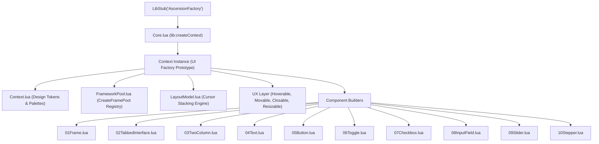
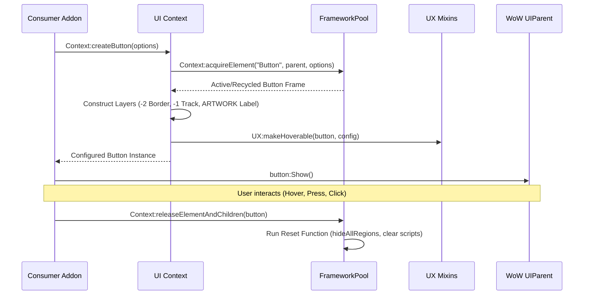

# AscensionFactory

An advanced, high-performance UI component library and layout framework for **World of Warcraft Retail (11.x / 12.x)** addons. Built with an **Obsidian & Cyberpunk Neon** design system, full memory recycling via Blizzard FramePools, procedural vector graphics, and an automatic cursor-based layout engine.

---

## Table of Contents

1. [Architecture Overview](#architecture-overview)
2. [Design System & Palette](#design-system--palette)
3. [Core Engine Subsystems](#core-engine-subsystems)
   - [Context Management](#context-management)
   - [Memory Pooling (FrameworkPool)](#memory-pooling-frameworkpool)
   - [Layout Model & Cursor Engine](#layout-model--cursor-engine)
   - [UX Interaction Modules](#ux-interaction-modules)
4. [Component API Reference](#component-api-reference)
   - [MainFrame](#mainframe)
   - [TabbedInterface](#tabbedinterface)
   - [TwoColumn](#twocolumn)
   - [Typography (Header, Label, Paragraph)](#typography)
   - [Buttons (Standard, Icon, Dialog)](#buttons)
   - [Toggle Switch](#toggle-switch)
   - [Checkbox](#checkbox)
   - [InputField](#inputfield)
   - [Slider & Scrollbar](#slider--scrollbar)
   - [Stepper](#stepper)
5. [Step-by-Step Recipes](#step-by-step-recipes)
6. [Component Extension Guide](#component-extension-guide)

---

## Architecture Overview

AscensionFactory is built upon an Object-Oriented metatable architecture wrapped inside LibStub. It separates design tokens, memory allocation, layout calculations, and interaction behaviors into distinct decoupled layers.

### System Architecture Diagram



### Component Lifecycle Flow



---

## Design System & Palette

All components consume standardized styling tokens from `uiContext.styles`. The default theme uses high-contrast Obsidian dark surfaces accented with vivid Neon lasers.

### Color Tokens

| Token | Hex / RGBA | Role / Usage |
| --- | --- | --- |
| `background` | `{0.008, 0.012, 0.020, 0.96}` | Deep Obsidian main window background |
| `panelBackground` | `{0.016, 0.024, 0.039, 0.60}` | Translucent container panel backdrop |
| `surfaceDark` | `{0.012, 0.020, 0.031, 0.90}` | Inner input and slider track background |
| `surfaceLight` | `{0.027, 0.039, 0.059, 0.90}` | Normal button and card surface |
| `surfaceHover` | `{0.055, 0.075, 0.110, 0.95}` | Hover state surface highlight |
| `border` | `{0.078, 0.102, 0.141, 1.00}` | Default structural frame border |
| `steelHighlight` | `{0.122, 0.153, 0.208, 1.00}` | Hover border highlight |
| `primary` | `{1.000, 0.380, 0.000, 1.00}` | Vivid Neon Orange accent & active border |
| `primaryHover` | `{1.000, 0.540, 0.050, 1.00}` | Laser Orange interactive hover state |
| `primaryActive` | `{0.700, 0.220, 0.000, 1.00}` | Deep Ember Orange pressed state |
| `neonRed` | `{1.000, 0.000, 0.150, 1.00}` | Close buttons and dangerous actions |
| `neonGreen` | `{0.000, 1.000, 0.400, 1.00}` | Confirm / Accept dialog actions |
| `white` | `{0.922, 0.973, 1.000, 1.00}` | Primary text labels and diamond thumbs |

---

## Core Engine Subsystems

### Context Management

[Core.lua](file:///Applications/World%20of%20Warcraft/_retail_/Interface/AddOns/AscensionFactory/Core/Core.lua)

Each consumer addon initializes an isolated Context:

```lua
local AscensionFactory = LibStub("AscensionFactory")
local uiContext = AscensionFactory:createContext()
```

Custom styles can be passed into `createContext(customStyles)` to override tokens per addon.

---

### Memory Pooling (FrameworkPool)

[FrameworkPool.lua](file:///Applications/World%20of%20Warcraft/_retail_/Interface/AddOns/AscensionFactory/Core/FrameworkPool.lua)

Prevents Lua garbage collection pauses by reusing Blizzard frames via `CreateFramePool`, `CreateTexturePool`, and `CreateFontStringPool`.

- `Context:acquireElement(elementType, parent, options)`: Returns a recycled or fresh widget instance (`"Frame"`, `"Button"`, `"StatusBar"`, `"CheckButton"`, `"EditBox"`, `"ScrollFrame"`, `"Slider"`, `"Model"`, `"Texture"`, `"FontString"`).
- `Context:releaseElement(elementType, element)`: Returns a single element to its pool.
- `Context:releaseElementAndChildren(element)`: Recursively resets and releases a frame along with all its child frames and regions.
- `Context:releaseAllElements()`: Resets and recycles all allocated pools.

---

### Layout Model & Cursor Engine

[LayoutModel.lua](file:///Applications/World%20of%20Warcraft/_retail_/Interface/AddOns/AscensionFactory/Core/LayoutModel.lua)

Provides dynamic cursor-based relative positioning. Developers stack widgets sequentially without hardcoding pixel coordinates.

```lua
local layout = uiContext:createLayoutModel(contentPanel)

layout:header("SectionHeader", "General Settings")
layout:addSpace(10)
layout:checkbox("AutoTargetCheckbox", "Enable Auto Target", getter, setter)
layout:button("ApplyButton", "Save Changes", nil, 120, 26, onClickCallback)
```

#### Layout Engine Features

- **Sections (`beginSection(width)` / `endSection()`)**: Wraps widgets in an Obsidian bordered card that automatically stretches its bottom to wrap enclosed contents.
- **Columns (`beginColumn(xOffset, width)` / `endColumn()` / `columnsFinalize(contentFrame, padding)`)**: Balances multi-column layouts and automatically sizes the parent container to match the tallest column.

---

### UX Interaction Modules

| Module | File | Method | Description |
| --- | --- | --- | --- |
| **Hoverable** | [Hoverable.lua](file:///Applications/World%20of%20Warcraft/_retail_/Interface/AddOns/AscensionFactory/UX/Hoverable.lua) | `UX:makeHoverable(element, config)` | Attaches unified `normal`, `hover`, `active`, `disabled` state management, custom color maps, and tooltips. |
| **Closable** | [Closable.lua](file:///Applications/World%20of%20Warcraft/_retail_/Interface/AddOns/AscensionFactory/UX/Closable.lua) | `UX:makeClosableWithEscape(frame, config)` | Binds Escape key to close the window, with optional pool release via `config.releaseOnHide`. |
| **Draggable** | [Draggable.lua](file:///Applications/World%20of%20Warcraft/_retail_/Interface/AddOns/AscensionFactory/UX/Draggable.lua) | `UX:makeMovable(frame, config)` | Enables left-click dragging, screen clamping, and automatic SavedVariables coordinate persistence. |
| **Resizable** | [Resizable.lua](file:///Applications/World%20of%20Warcraft/_retail_/Interface/AddOns/AscensionFactory/UX/Resizable.lua) | `UX:makeResizable(frame, minW, minH)` | Adds a bottom-right drag handle with `SetResizeBounds` constraints. |

---

## Component API Reference

> [!NOTE]
> For a complete quick-reference matrix of all constructors, sub-elements, and option properties, see the [Components Index](file:///Applications/World%20of%20Warcraft/_retail_/Interface/AddOns/AscensionFactory/Components/README.md).

### MainFrame

[01Frame.lua](file:///Applications/World%20of%20Warcraft/_retail_/Interface/AddOns/AscensionFactory/Components/01Frame.lua)

Creates a styled top-level application window with background, border, close button, dragging, and escape key closure.

```lua
local frame = uiContext:createMainFrame({
    name = "MyAddonMainWindow",
    width = 800,
    height = 500,
    anchor = "CENTER",
    strata = "DIALOG",
    showCloseButton = true,
    onClose = function(self) self:Hide() end
})
```

#### Options Table

- `name` *(string, required)*: Global variable identifier for the frame.
- `width` *(number, default: 860)*: Window width in pixels.
- `height` *(number, default: 500)*: Window height in pixels.
- `anchor` *(string, default: "CENTER")*: Screen anchor point.
- `strata` *(string, default: "DIALOG")*: Frame strata layer.
- `showCloseButton` *(boolean, default: true)*: Renders top-right close icon button.
- `onClose` *(function)*: Callback executed when close button is clicked.
- `releaseOnHide` *(boolean, default: false)*: Automatically recycles frame to pool when hidden.

---

### TabbedInterface

[02TabbedInterface.lua](file:///Applications/World%20of%20Warcraft/_retail_/Interface/AddOns/AscensionFactory/Components/02TabbedInterface.lua)

Creates a sidebar navigation with tab buttons and dynamic content panels.

```lua
local tabSystem = uiContext:createTabbedInterface({
    parent = mainFrame,
    startY = -40,
    initialIndex = 1,
    tabs = { "General", "Combat", "Profiles" }
})

local generalPanel = tabSystem.panels[1]
local combatPanel = tabSystem.panels[2]
```

#### Return Table

- `sidebar`: The left vertical navigation container frame.
- `tabs`: Array of tab button frames.
- `panels`: Array of content container frames (indexed 1..N).

---

### TwoColumn

[03TwoColumn.lua](file:///Applications/World%20of%20Warcraft/_retail_/Interface/AddOns/AscensionFactory/Components/03TwoColumn.lua)

Splits the parent width evenly into a left and right frame.

```lua
local leftCol, rightCol = uiContext:createTwoColumns({
    parent = contentPanel,
    yOffset = -10,
    height = 200,
    name = "MySettingsColumns"
})
```

---

### Typography

[04Text.lua](file:///Applications/World%20of%20Warcraft/_retail_/Interface/AddOns/AscensionFactory/Components/04Text.lua)

```lua
local header, nextY = uiContext:createHeader({ parent = panel, text = "Combat Options", fontSize = 24 })
local label, nextY  = uiContext:createLabel({ parent = panel, text = "Targeting Mode", fontSize = 16, yOffset = nextY })
local para, nextY   = uiContext:createParagraph({ parent = panel, text = "Long descriptive text...", yOffset = nextY })
```

---

### Buttons

[05Button.lua](file:///Applications/World%20of%20Warcraft/_retail_/Interface/AddOns/AscensionFactory/Components/05Button.lua)

#### 1. Standard Button

```lua
local btn = uiContext:createButton({
    parent = panel,
    text = "Save Settings",
    width = 140,
    height = 28,
    onClick = function(self) print("Saved!") end
})
```

#### 2. Icon Button

`iconType`: `"close"`, `"minus"`, `"plus"`, `"minimize"`, `"maximize"`, `"arrowdown"`.
```lua

local iconBtn = uiContext:createIconButton({
    parent = panel,
    iconType = "plus",
    size = 24,
    onClick = function() print("Added") end
})
```

#### 3. Dialog Button

`variant`: `"accept"` (Green Neon), `"cancel"` (Red Neon), `"neutral"` (Orange Neon).

```lua
local acceptBtn = uiContext:createDialogButton({
    parent = panel,
    variant = "accept",
    text = "Confirm",
    onClick = function() ... end
})
```

---

### Toggle Switch

[06Toggle.lua](file:///Applications/World%20of%20Warcraft/_retail_/Interface/AddOns/AscensionFactory/Components/06Toggle.lua)

Binary switch with sliding thumb block and multi-state neon lighting.

```lua
local toggle = uiContext:createToggle({
    parent = panel,
    width = 52,
    height = 24,
    getter = function() return MyAddonDB.enabled end,
    setter = function(state) MyAddonDB.enabled = state end,
    onClick = function(self, state) print("Toggled:", state) end
})
```

#### Public Instance Methods

- `toggle:setState(state)`: Updates boolean state and slides thumb.

---

### Checkbox

[07Checkbox.lua](file:///Applications/World%20of%20Warcraft/_retail_/Interface/AddOns/AscensionFactory/Components/07Checkbox.lua)

Geometric vector checkmark rendered without raster image assets.

```lua
local checkbox = uiContext:createCheckbox({
    parent = panel,
    text = "Auto Repair Equipment",
    checked = true,
    setter = function(val) MyAddonDB.autoRepair = val end
})
```

#### Checkbox Public Instance Methods

- `checkbox:getChecked()` -> `boolean`
- `checkbox:setChecked(isChecked)`
- `checkbox:setText(newText)`

---

### InputField

[08InputField.lua](file:///Applications/World%20of%20Warcraft/_retail_/Interface/AddOns/AscensionFactory/Components/08InputField.lua)

Unified text input supporting single-line entries, multi-line areas, numeric filtering, ghost placeholder text, clear button, and focus glows.

```lua
local input = uiContext:createInputField({
    parent = panel,
    width = 240,
    height = 26,
    placeholder = "Search inventory...",
    showClear = true,
    onTextChanged = function(self, text, isUserInput) ... end,
    onEnterPressed = function(self, text) ... end
})
```

#### InputField Public Instance Methods

- `input:getText()` -> `string`
- `input:setText(newText)`
- `input:clear()`
- `input:setPlaceholder(placeholderText)`
- `input:setNumeric(isNumeric)`
- `input:setMaxLetters(maxLetters)`
- `input:setFocus()`
- `input:clearFocus()`
- `input:setEnabled(enabled)`
- `input:getEditBox()` -> Native EditBox

---

### Slider & Scrollbar

[09Slider.lua](file:///Applications/World%20of%20Warcraft/_retail_/Interface/AddOns/AscensionFactory/Components/09Slider.lua)

Supports horizontal and vertical orientations, rotated diamond thumb handle, progress bar fill, mouse wheel adjustments, and discrete step snapping.

```lua
local slider = uiContext:createSlider({
    parent = panel,
    orientation = "HORIZONTAL",
    length = 260,
    thickness = 16,
    minValue = 0,
    maxValue = 100,
    step = 5,
    value = 50,
    showFill = true,
    onValueChanged = function(self, val, isUserInput)
        print("Value:", val)
    end
})
```

#### Slider & Scrollbar Public Instance Methods

- `slider:getValue()` -> `number`
- `slider:setValue(val, isSilent, isUserInput)`
- `slider:setMinMaxValues(minVal, maxVal)`
- `slider:getMinMaxValues()` -> `minVal, maxVal`
- `slider:setStep(newStep)`
- `slider:setFill(enabled)`

---

### Stepper

[10Stepper.lua](file:///Applications/World%20of%20Warcraft/_retail_/Interface/AddOns/AscensionFactory/Components/10Stepper.lua)

Composited numeric stepper featuring seamless joined borders, minus icon button, centered input field, plus icon button, hold-to-repeat ticker, and mouse wheel support.

```lua
local stepper = uiContext:createStepper({
    parent = panel,
    width = 140,
    height = 26,
    minValue = 0,
    maxValue = 100,
    step = 1,
    value = 25,
    decimals = 0,
    onValueChanged = function(self, val, isUserInput)
        print("Stepper value:", val)
    end
})
```

#### Stepper Public Instance Methods

- `stepper:getValue()` -> `number`
- `stepper:setValue(val, isSilent, isUserInput)`
- `stepper:setMinMaxValues(minVal, maxVal)`
- `stepper:setStep(newStep)`
- `stepper:setEnabled(enabled)`
- `stepper:getInputField()` -> InputField container
- `stepper:getMinusButton()` -> Minus Button
- `stepper:getPlusButton()` -> Plus Button

---

## Step-by-Step Recipes

### Complete Settings Window Recipe

```lua
local AscensionFactory = LibStub("AscensionFactory")
local uiContext = AscensionFactory:createContext()

local function createSettingsWindow()
    -- 1. Create Main Window
    local window = uiContext:createMainFrame({
        name = "MyAddonSettingsFrame",
        width = 750,
        height = 480
    })

    -- 2. Window Header
    local header, nextY = uiContext:createHeader({
        parent = window,
        text = "My Addon Configuration",
        xOffset = 15,
        yOffset = -12,
        fontSize = 26
    })

    -- 3. Tabbed Sidebar Navigation
    local tabs = uiContext:createTabbedInterface({
        parent = window,
        startY = nextY,
        initialIndex = 1,
        tabs = { "General", "Display", "About" }
    })

    -- 4. General Tab Layout
    local generalPanel = tabs.panels[1]
    local layout = uiContext:createLayoutModel(generalPanel)

    layout:header("GeneralHeader", "Gameplay Tweaks")
    layout:addSpace(10)
    
    layout:checkbox("AutoLootCheck", "Enable Fast Auto-Loot", function()
        return MyAddonDB.autoLoot
    end, function(val)
        MyAddonDB.autoLoot = val
    end)
    
    layout:addSpace(8)
    layout:toggle("CombatLockToggle", function()
        return MyAddonDB.combatLock
    end, function(val)
        MyAddonDB.combatLock = val
    end)

    window:Show()
    return window
end
```

